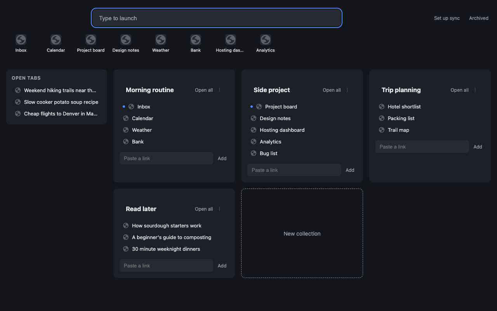
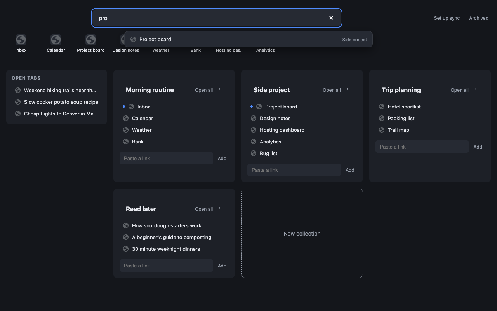

# Tab Organizer 🗂️

**A Chrome new tab page that saves your tabs into collections and finds any of them as you type.** Drag an open tab onto a collection and it's saved and closed. Your links sync between your computers through a Cloudflare Worker you run yourself, so there's no account and no subscription.

I built it so I'd stop paying for a tab organizer subscription. It's one person's tool, made to be easy to read and easy to make your own.



---

## What it does

| Feature | What you get |
|---|---|
| **Collections** | A flat list of named collections, each holding links. No nested folders, tags or notes, on purpose. |
| **Save a tab** | Drag an open tab from the side panel onto a collection. It's saved as a link and the tab closes. Or paste a link into a collection's add box. |
| **Type to launch** | Start typing anywhere on the page to search every saved link by title or address. Arrow keys and Enter open it, Ctrl or Cmd + Enter opens it in the background. |
| **Frequent row** | Your 8 most-clicked links sit on a shelf above everything else. |
| **Open all** | One click opens every link in a collection as background tabs. |
| **Star** | A starred link always sorts first in its collection. |
| **Archive** | Hides a collection without deleting it. The Archived button brings it back. |
| **Rename, reorder, delete** | Each collection's menu renames, archives or deletes it. Drag a collection by its header to reorder it, and drag a link to reorder it or move it to another collection. |
| **Open tabs panel** | A side list of the tabs open in this window. Click one to jump to it, or drag it onto a collection to save it. |
| **Sync** | Every change is saved in the browser first, so the page paints instantly and works offline. A background sync sends changes to your Worker when it can. |



---

## Run your own copy

You need Chrome, Node.js 22 or newer (Wrangler, Cloudflare's command-line tool, asks for it), and a Cloudflare account for sync.

### 1. Get the code

```bash
git clone https://github.com/jensoltys/taborganizer.git
cd taborganizer
npm run setup
```

### 2. Load the extension

1. Open `chrome://extensions` and turn on **Developer mode** (top right).
2. Click **Load unpacked** and pick the `extension` folder inside this repo.
3. Open a new tab.

That's enough to use it on one computer. With no Worker set up, everything stays in this browser, and a **Set up sync** button sits in the header for later.

### 3. Set up sync (optional, for more than one computer)

```bash
cd worker
npx wrangler login
npx wrangler d1 create tab-organizer-db
```

If Wrangler offers to add the database to your config file for you, say no. Paste the `database_id` it prints into `worker/wrangler.toml` yourself, in place of `YOUR_D1_DATABASE_ID`. Then:

```bash
npx wrangler d1 migrations apply tab-organizer-db --remote
npx wrangler deploy
node ../scripts/make-token.mjs
npx wrangler secret put API_TOKEN_HASH
```

Pulling a newer version later? Run the `migrations apply` line again before `wrangler deploy`, so the database has any new table the Worker expects.

`make-token.mjs` prints a token and its hash. Paste the **hash** when `wrangler secret put` asks for it. Save the **token** in your password manager. The Worker only keeps the hash, so a lost token means making a new one.

Check the Worker is up (use the address `wrangler deploy` printed):

```bash
curl https://tab-organizer.<your-subdomain>.workers.dev/health
```

It should answer `ok`.

### 4. Connect the extension

1. Click **Set up sync** on the new tab page (or open the extension's Options).
2. Paste your Worker address and the token.
3. Click **Save** and allow Chrome to reach that address when it asks.
4. Click **Test connection**. It should say "Connected."

Repeat steps 2 and 4 on each computer.

### Settings

| Setting | Where | Required? | What it's for |
|---|---|---|---|
| `database_id` | `worker/wrangler.toml` | For sync | Your own D1 database. |
| `API_TOKEN_HASH` | Worker secret (`wrangler secret put`) | For sync | SHA-256 hash of your token. Until this is set, the Worker refuses everything except the `/health` check. |
| Worker address + token | Extension Options page | For sync | Where the extension sends changes, and the key it uses. |

To test on your own computer with no Cloudflare account, run these from the `worker` folder:

```bash
cp .dev.vars.example .dev.vars
node ../scripts/make-token.mjs
npx wrangler d1 migrations apply tab-organizer-db --local
npx wrangler dev
```

Put the hash from `make-token.mjs` into `.dev.vars` before the last two commands. The Options page accepts the `http://localhost` address that `wrangler dev` prints.

---

## How it's built

```
Chrome extension                          Your Cloudflare account
┌──────────────────────────┐              ┌───────────────────────┐
│ new tab page              │   changes   │ Worker                │
│  saves to the browser     │ ──────────▶ │  checks the token     │
│  first, paints instantly  │  /api/sync  │  applies changes      │
│                           │ ◀────────── │                       │
│                           │  /api/state │ D1 database           │
└──────────────────────────┘              └───────────────────────┘
```

- **Changes are queued, not sent straight away.** Every action (rename, add, star, archive, delete, click) becomes a small change record. It's applied to the browser copy at once and queued for the Worker, so nothing waits on the network.
- **Changes go up in small batches.** Cloudflare's free plan allows 50 database queries per Worker request, so the extension sends 20 changes at a time and only clears a batch once the Worker says it's stored. Collections are sent before the links inside them.
- **Last write wins, except clicks.** The Worker keeps a change only if it's at least as new as what it already has. Clicks always add one, so clicks from two computers that were offline both count.
- **One token, stored as a hash.** The extension sends `Authorization: Bearer <token>`. The Worker hashes it and compares it in constant time with `API_TOKEN_HASH`. It never stores the token itself.
- **The extension can only reach your Worker.** It ships with no site access. When you save your Worker address, Chrome asks you to allow that one address.
- **Favicons come from Chrome.** They're loaded from Chrome's own favicon cache at draw time. No outside favicon service, nothing stored.

| Folder | What's in it |
|---|---|
| `extension/lib/` | The logic with no page code: storage, the sync queue, search scoring. Tested without a browser. |
| `extension/newtab/` | The new tab page: drawing, drag and drop, search keys. |
| `extension/options/` | The page where you paste your Worker address and token. |
| `worker/src/` | The Worker: token check, routes, and every rule for how changes are applied. |
| `worker/migrations/` | The tables: `collections`, `links`, and `click_ops` (click ids already counted, so a resent batch can't count a click twice). |
| `scripts/` | `make-token.mjs` and the security check. |

---

## Keep your copy safe

- Make your token with `make-token.mjs` (32 random bytes). Don't pick one by hand.
- Set `API_TOKEN_HASH` with `wrangler secret put`, never in `wrangler.toml` or a committed file.
- Never commit `worker/.dev.vars`. It's in `.gitignore`, and `npm test` fails if it's ever tracked.
- Lost a token, or think someone saw it? Make a new one, `wrangler secret put` the new hash, and paste the new token on each computer. The old one stops working right away.
- **Watch this repo** (Watch > Custom > Security alerts) to hear about security fixes. See [SECURITY.md](SECURITY.md).

---

## Tests

```bash
npm test
```

That runs the Worker tests, the extension tests and `scripts/test-security.mjs`, a check that fails on tracked secret files, hard-coded keys and unsafe page code.

---

## Made by

**Jen Soltys**. I build small apps that fix everyday annoyances at **[Jen Built It](https://jenbuiltit.com)** and write about building with AI at **[jen8n.com](https://jen8n.com)**.

## Contributing

Bug reports and ideas are welcome in [Issues](../../issues). I'm not taking pull requests right now. You're free to fork it and make it yours under the license below. See [CONTRIBUTING.md](CONTRIBUTING.md), [SUPPORT.md](SUPPORT.md) and the [code of conduct](CODE_OF_CONDUCT.md).

## License

[MIT](LICENSE). Use it, change it, share it. If you publish a changed copy, give it your own name so nobody mistakes it for the original.

Chrome is a trademark of Google LLC. Cloudflare is a trademark of Cloudflare, Inc. Tab Organizer isn't affiliated with or endorsed by either of them.
